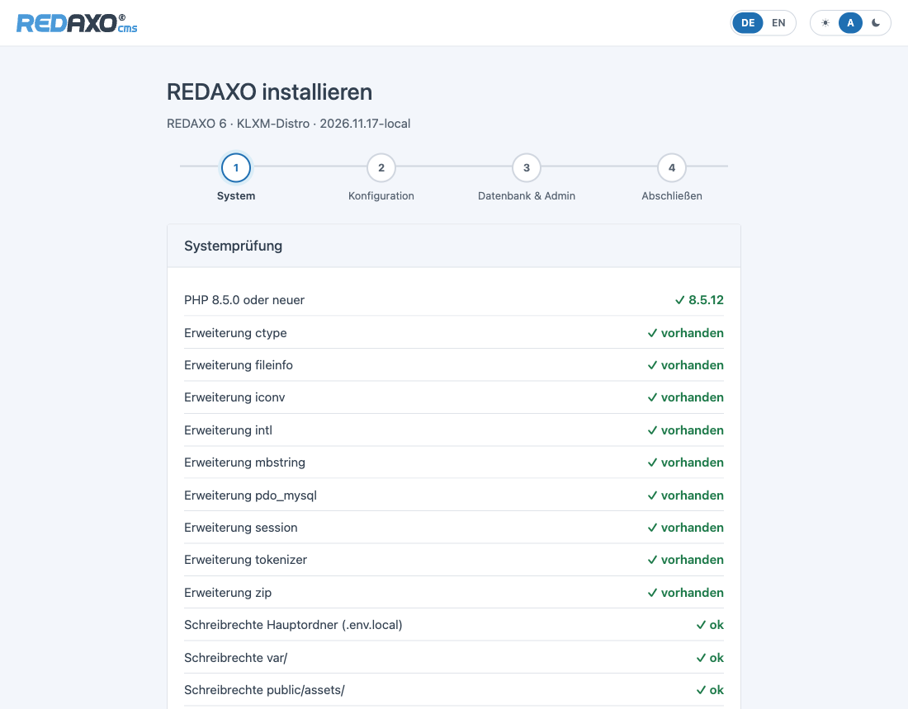
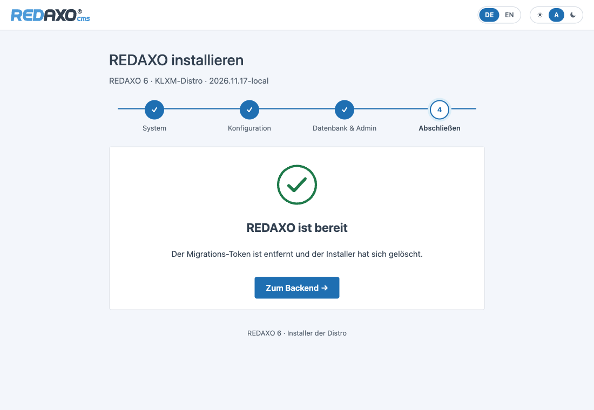

# REDAXO 6 Distro Builder

Ein Template von [KLXM Crossmedia](https://klxm.de).

Vorlage, um eigene **REDAXO-6-Distributionen** zu bauen: REDAXO plus eine feste Auswahl an AddOns als fertiges ZIP.
Composer läuft dabei nur auf GitHub. Wer installiert, braucht weder Composer noch Shell.

Jeder Build erzeugt ein Release mit:

| Datei | Wofür |
| --- | --- |
| `<distro>-<version>.zip` | **Neu installieren**: hochladen, entpacken, `install.php` aufrufen |
| `<distro>-<version>-update.zip` | **Aktualisieren**: enthält nur `vendor/` und die Composer-Dateien. Projekt, `.env`, Medien und `var/` bleiben unberührt |
| `manifest.json` | Version, Paketliste, Anforderungen, Prüfsummen (für einen Updater) |

## Eigene Distro in 3 Schritten

1. **Use this template** → eigenes Repository anlegen (darf privat sein).
2. In `composer.json` die AddOns eintragen (aus Packagist oder als `repositories`-Eintrag), in `distro.json`
   Name und Kanal (`stable` oder `dev`) setzen.
3. Unter **Actions → Update** den ersten Lauf starten. Er legt die `composer.lock` an und stößt den **Build** an.
   Danach liegt das Release unter **Releases**.

Der Workflow **Update** läuft jede Woche. Gibt es neue Versionen von Core oder AddOns, entsteht automatisch ein
neuer Build.

## Installieren (für Anwender)

1. Das ZIP entpacken und alles hochladen.
2. Den Webserver auf `public/` zeigen lassen. Geht das beim Hoster nicht, leitet die `.htaccess` im Hauptordner
   dorthin weiter.
3. `https://deine-domain/install.php` aufrufen. Der Installer sieht aus wie das REDAXO-Backend, kennt Hell- und
   Dunkelmodus und spricht Deutsch und Englisch.

| 1 · System | 2 · Konfiguration |
| --- | --- |
|  |  |

| Dunkel und Englisch | Fertig |
| --- | --- |
|  |  |

So läuft es ab:

1. **System:** prüft PHP-Version, Erweiterungen und Schreibrechte.
2. **Konfiguration:** Datenbank mit Verbindungstest (legt sie bei Bedarf an), Name, Adresse und Modus. Daraus
   schreibt der Installer die `.env.local`, mit zufälliger Instanz-ID und einmaligem Migrations-Token.
3. **Datenbank und Admin:** Die Migrationsseite des Cores (`/redaxo/?rex_migrate=…`) legt die Tabellen und den
   ersten Admin an.
4. **Abschließen:** Der Installer entfernt den Migrations-Token und löscht sich selbst.

## Aktualisieren

`*-update.zip` enthält nur `vendor/` und die Composer-Dateien. Projekt (`src/`), `.env`/`.env.local`, `var/` und
Medien bleiben unberührt.

1. **Sichern:** Datenbank und den bisherigen Ordner `vendor/`.
2. **`vendor/` austauschen, nicht darüber entpacken.** Den alten Ordner umbenennen, z. B. in `vendor.old/`, und den
   neuen an seine Stelle legen. Beim Entpacken über den alten Ordner blieben Dateien liegen, die es in der neuen
   Version nicht mehr gibt.
3. **Sofort migrieren**, über die Konsole:

   ```bash
   php bin/console migrate
   ```

   Oder ohne Shell:

   1. In `.env.local` die Zeile `REX_MIGRATE_TOKEN=<langer Zufallswert>` ergänzen.
   2. `https://deine-domain/redaxo/?rex_migrate=<derselbe Wert>` aufrufen.
   3. Danach die Zeile wieder entfernen.
4. Läuft alles, `vendor.old/` löschen. Geht etwas schief, den alten Ordner zurückbenennen und erneut migrieren.

### Warum `migrate` nach jedem Update Pflicht ist

- **Assets:** CSS, JS und Bilder von Core und AddOns liegen im Paket unter `vendor/<paket>/assets/`. Erst `migrate`
  veröffentlicht sie nach `public/assets/`. Der Core löscht dabei den alten Stand jedes AddOns und kopiert den neuen
  hinein, veraltete Dateien bleiben also nicht liegen. Deshalb ist `public/assets/` auch nicht im Update-Paket.
- **Datenbank:** Neue Tabellen, Spalten und Migrationsschritte der neuen Versionen werden angewendet.
- **Cache:** Zwischengespeicherte Daten passen danach wieder zum Code.

Bis `migrate` gelaufen ist, arbeitet neuer PHP-Code mit alten Assets und altem Datenbankschema. Tausch und Migration
gehören deshalb direkt zusammen.

Ein Updater-AddOn, das das im Backend erledigt (Prüfsumme, Sicherung, Tausch, Migration, Rückfall), ist der
nächste Schritt.

## Lokal bauen

```bash
composer update --no-install   # composer.lock aktualisieren
php tools/build.php            # Ergebnis in dist/
```

Voraussetzung: PHP 8.5 mit `zip`, Composer 2.

## Aufbau

```
composer.json / composer.lock   Core und AddOns der Distro
distro.json                     Kennung, Titel, Kanal
skeleton/                       Projektgerüst (redaxo/project) plus public/install.php
tools/build.php                 Build: Projekt zusammenstellen, composer install, ZIPs, Manifest
.github/workflows/              build.yml (Release), update.yml (wöchentlich neue Versionen)
```
