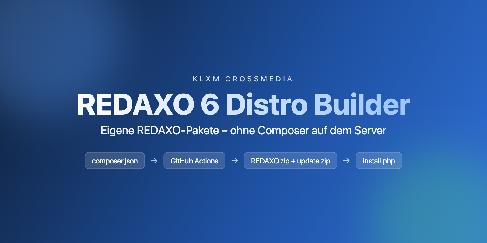
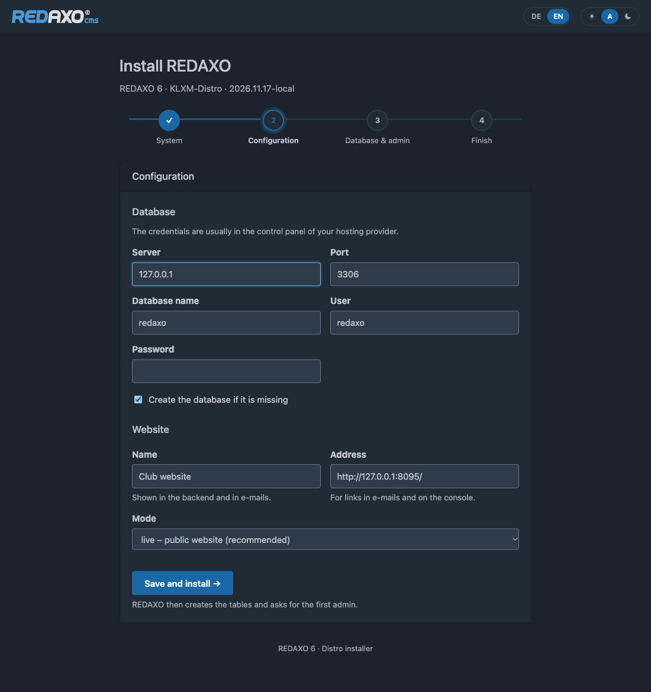
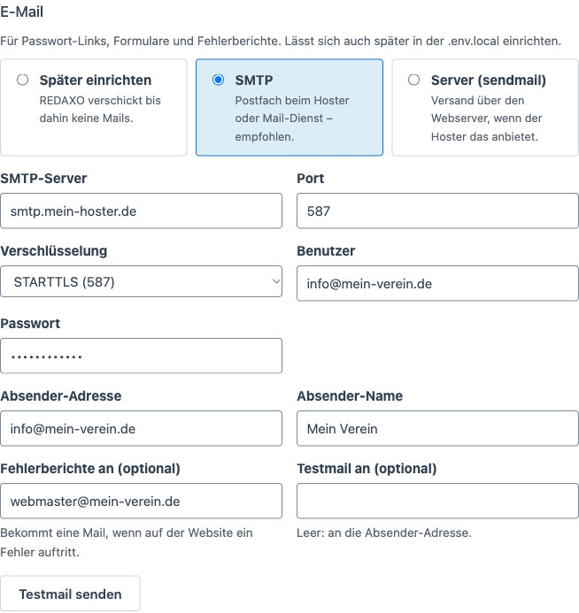
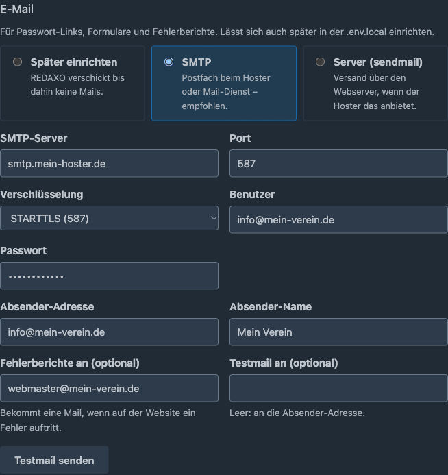

# REDAXO 6 Distro Builder

Ein Template von [KLXM Crossmedia](https://klxm.de).

Vorlage, um eigene **REDAXO-6-Distributionen** zu bauen: REDAXO plus eine feste Auswahl an AddOns als fertiges ZIP.
Composer läuft dabei nur auf GitHub. Wer installiert, braucht weder Composer noch Shell.

Jeder Build erzeugt ein Release mit:

| Datei | Wofür |
| --- | --- |
| `<distro>-<version>.zip` | **Neu installieren**: hochladen, entpacken, `install.php` aufrufen |
| `<distro>-<version>-update.zip` | **Aktualisieren**: enthält nur `vendor/` und die Composer-Dateien. Projekt, `.env`, Medien und `var/` bleiben unberührt |
| `manifest.json` | Version, Paketliste, Anforderungen, Prüfsummen (für einen Updater) |

## Eigene Distro in 3 Schritten

1. **Use this template** → eigenes Repository anlegen (darf privat sein).
2. In `composer.json` die AddOns eintragen (aus Packagist oder als `repositories`-Eintrag), in `distro.json`
   Name und Kanal (`stable` oder `dev`) setzen.
3. Unter **Actions → Update** den ersten Lauf starten. Er legt die `composer.lock` an und stößt den **Build** an.
   Danach liegt das Release unter **Releases**.

Der Workflow **Update** läuft jede Woche. Gibt es neue Versionen von Core oder AddOns, entsteht automatisch ein
neuer Build.

## Installieren (für Anwender)

1. Das ZIP entpacken und alles hochladen.
2. Den Webserver auf `public/` zeigen lassen. Geht das beim Hoster nicht, leitet die `.htaccess` im Hauptordner
   dorthin weiter.
3. `https://deine-domain/install.php` aufrufen. Der Installer sieht aus wie das REDAXO-Backend, kennt Hell- und
   Dunkelmodus und spricht Deutsch und Englisch.

| 1 · System | 2 · Konfiguration |
| --- | --- |
|  |  |

| Dunkel und Englisch | Fertig |
| --- | --- |
|  |  |

| E-Mail (optional) | E-Mail, dunkel |
| --- | --- |
|  |  |

So läuft es ab:

1. **System:** prüft PHP-Version, Erweiterungen und Schreibrechte.
2. **Konfiguration:** Datenbank mit Verbindungstest (legt sie bei Bedarf an), Name, Adresse und Modus. Daraus
   schreibt der Installer die `.env.local`, mit zufälliger Instanz-ID und einmaligem Migrations-Token.
   Wahlweise gleich die **E-Mail** einrichten: SMTP (Postfach beim Hoster), sendmail des Servers oder „später“.
   Dazu Absender und Empfänger für Fehlerberichte. Der Knopf **Testmail senden** prüft die Daten sofort. Der
   Installer schreibt sie als `MAILER_DSN`, `REX_MAILER_FROM` und `REX_ERROR_EMAIL` in die `.env.local`.
3. **Datenbank und Admin:** Die Migrationsseite des Cores (`/redaxo/?rex_migrate=…`) legt die Tabellen und den
   ersten Admin an.
4. **Abschließen:** Der Installer entfernt den Migrations-Token und löscht sich selbst.

## Aktualisieren

Ein Update braucht nur ein FTP-Programm (z. B. FileZilla) und den Browser, kein Terminal.

`*-update.zip` enthält nur den Ordner `vendor/` mit REDAXO und den AddOns, dazu die Composer-Dateien. Deine Inhalte
bleiben unberührt: Projekt-Dateien (`src/`), Einstellungen (`.env.local`), Medien und `var/`.

1. **Sichern:** Beim Hoster ein Backup der Datenbank anlegen und per FTP den Ordner `vendor/` herunterladen.
2. **Neues Paket vorbereiten:** `*-update.zip` auf dem eigenen Rechner entpacken.
3. **`vendor/` austauschen:**
   1. Auf dem Server per FTP `vendor/` umbenennen in `vendor.old/`.
   2. Den neuen Ordner `vendor/` hochladen, dazu `composer.json`, `composer.lock` und `distro-manifest.json`.

   Bitte nicht einfach über den alten Ordner hochladen. Dabei blieben Dateien liegen, die es in der neuen Version
   nicht mehr gibt.
4. **Sofort die Aktualisierung abschließen:**
   1. Per FTP die Datei `.env.local` im Hauptordner öffnen. FileZilla bietet dafür „Ansehen/Bearbeiten“.
   2. Eine Zeile ergänzen, z. B. `REX_MIGRATE_TOKEN=update-2026-11-17-geheim`. Wähle einen eigenen, langen Wert.
   3. Im Browser `https://deine-domain/redaxo/?rex_migrate=update-2026-11-17-geheim` aufrufen, mit demselben Wert,
      und auf **„Run migration“** klicken. Die Seite meldet danach „Migration completed“ und „The database is in line
      with the code“.
   4. Die Zeile in `.env.local` wieder löschen.
5. **Prüfen:** Website und Backend aufrufen. Läuft alles, `vendor.old/` per FTP löschen. Geht etwas schief, den
   neuen `vendor/` löschen, `vendor.old/` zurück in `vendor/` umbenennen und Schritt 4 wiederholen.

Wer ein Terminal auf dem Server hat, kann Schritt 4 auch mit `php bin/console migrate` erledigen.

Das geplante Updater-AddOn macht daraus einen Klick im Backend: Paket prüfen, sichern, austauschen, migrieren und
bei Fehlern zurückrollen.

### Warum Schritt 4 nach jedem Update nötig ist

- **Assets:** CSS, JS und Bilder von Core und AddOns liegen im Paket unter `vendor/<paket>/assets/`. Erst `migrate`
  veröffentlicht sie nach `public/assets/`. Der Core löscht dabei den alten Stand jedes AddOns und kopiert den neuen
  hinein, veraltete Dateien bleiben also nicht liegen. Deshalb ist `public/assets/` auch nicht im Update-Paket.
- **Datenbank:** Neue Tabellen, Spalten und Migrationsschritte der neuen Versionen werden angewendet.
- **Cache:** Zwischengespeicherte Daten passen danach wieder zum Code.

Bis die Migration gelaufen ist, arbeitet neuer PHP-Code mit alten Assets und altem Datenbankschema. Tausch und Migration
gehören deshalb direkt zusammen.

## Lokal bauen

```bash
composer update --no-install   # composer.lock aktualisieren
php tools/build.php            # Ergebnis in dist/
```

Voraussetzung: PHP 8.5 mit `zip`, Composer 2.

## Aufbau

```
composer.json / composer.lock   Core und AddOns der Distro
distro.json                     Kennung, Titel, Kanal
skeleton/                       Projektgerüst (redaxo/project) plus public/install.php
tools/build.php                 Build: Projekt zusammenstellen, composer install, ZIPs, Manifest
.github/workflows/              build.yml (Release), update.yml (wöchentlich neue Versionen)
```
